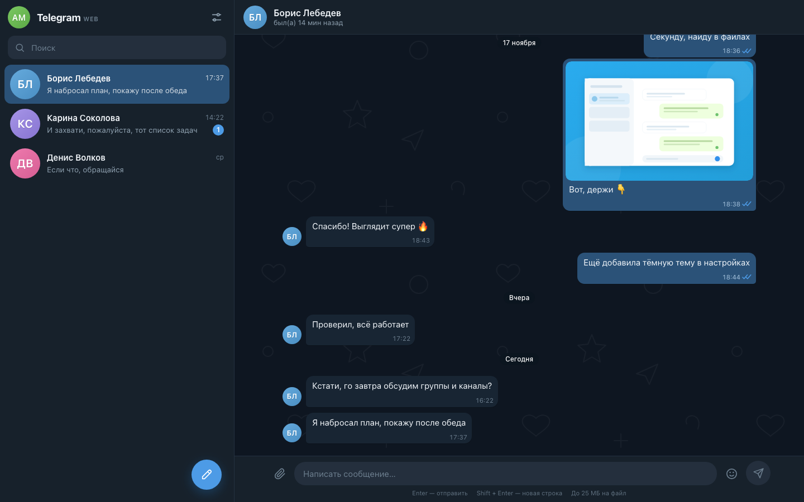

# Telegram Web — демо-мессенджер

[](https://github.com/hotokens/tg-web-analog/actions/workflows/ci.yml)

Аналог Telegram Web: личные чаты в реальном времени, редактирование сообщений, реакции,
форматирование текста, медиа и файлы, профиль и настройки.
React + TypeScript + Vite на клиенте, Express + Socket.IO + SQLite на сервере.

Репозиторий: [github.com/hotokens/tg-web-analog](https://github.com/hotokens/tg-web-analog)

## Быстрый старт

```bash
git clone git@github.com:hotokens/tg-web-analog.git
cd tg-web-analog
npm install
npm run dev
```

Если SSH не настроен, используйте HTTPS:

```bash
git clone https://github.com/hotokens/tg-web-analog.git
```

- Клиент: http://localhost:5173
- API: http://localhost:3001

Демо-аккаунты (пароль `123456`):

| Логин | Имя |
| --- | --- |
| `alice` | Алиса Морозова |
| `bob` | Борис Лебедев |
| `carol` | Карина Соколова |
| `dave` | Денис Волков |
| `maria` | Мария Кузнецова |
| `igor` | Игорь Белов |

Чтобы увидеть real-time: откройте второе окно в режиме инкогнито, войдите под другим аккаунтом и напишите сообщение.
Индикатор «печатает…», статусы онлайн и галочки прочтения работают между окнами.

## Возможности

- Личные чаты с доставкой сообщений через Socket.IO
- История сообщений с подгрузкой при прокрутке вверх
- Индикатор набора текста, статусы «в сети» / «был(а) недавно», прочтение (одна/две галочки)
- Непрочитанные сообщения и счётчики в списке чатов, счётчик в заголовке вкладки
- Редактирование своих сообщений с пометкой «изменено» и live-синхронизацией
- Реакции: 👍 ❤️ 🔥 😂 😮 😢 🙏 🎉, можно ставить несколько разных на одно сообщение
- Форматирование: жирный, курсив, зачёркнутый, код, блоки кода с подсветкой и спойлеры
- Отправка изображений и файлов: кнопка, drag & drop, вставка из буфера
- Превью изображений, полноэкранный просмотр, скачивание файлов
- Поиск по чатам, поиск людей и создание новых диалогов
- Профиль: имя, описание, аватар; светлая и тёмная темы
- Адаптивная вёрстка: на мобильных список и чат — отдельные экраны
- Демо-данные: 6 пользователей, 4 диалога, история и пример изображения

## Форматирование

Поддерживается Markdown-подмножество:

| Синтаксис | Результат |
| --- | --- |
| `**текст**` | **жирный** |
| `__текст__` | *курсив* |
| `~~текст~~` | ~~зачёркнутый~~ |
| `` `код` `` | `моноширинный текст` |
| `\*` | экранирование символа |

Спойлер: `||текст||` — скрыт размытием и раскрывается по клику.

Блоки кода:

````markdown
```javascript
let a = "foo";
```
````

Название языка выносится в заголовок блока, код подсвечивается с учётом светлой и тёмной темы.
Поддерживаются JavaScript, TypeScript, JSX/TSX, JSON, CSS, HTML/XML, Markdown, Python, Go, Rust,
Swift, Kotlin, C/C++, SQL и YAML. Для `text`, неизвестных языков, а также Bash/Java/SCSS
показывается заголовок без подсветки.

Реакции и редактирование работают в реальном времени через Socket.IO.

## Скриншоты

| Переписка · светлая тема | Переписка · тёмная тема |
| --- | --- |
|  |  |

| Список чатов | Мобильный вид |
| --- | --- |
|  |  |

## Скрипты

```bash
npm run dev          # клиент + сервер одновременно
npm run dev:client   # только Vite (:5173)
npm run dev:server   # только API (:3001)
npm run build        # production-сборка клиента
npm start            # сервер + собранный клиент на :3001
npm run typecheck    # проверка типов клиента и сервера
```

Production-режим:

```bash
npm run build
npm start
# http://localhost:3001
```

## Структура

```
client/                  React + Vite
  src/
    api.ts               REST-клиент
    formatting.tsx       Markdown-парсер, спойлеры и подсветка кода
    socket.ts            Socket.IO-клиент
    store.ts             Zustand: сессия, чаты, сообщения, темы, редактирование
    components/          UI (сайдбар, чат, composer, модалки)
    styles.css           токены тем и все стили
server/                  Express + Socket.IO
  src/
    db.ts                схема SQLite и демо-сиды
    reactions.ts         логика реакций
    realtime.ts          сокеты: сообщения, редактирование, реакции, typing, presence
    routes/              auth, users, chats, upload, profile
    uploads/             загруженные файлы (создаётся автоматически)
    data/app.db          база SQLite (создаётся автоматически)
docs/screenshots/        скриншоты для README
.github/workflows/       CI: typecheck и сборка клиента
```

## API

| Метод | Путь | Описание |
| --- | --- | --- |
| POST | `/api/auth/login` | Вход по username и паролю |
| GET | `/api/auth/me` | Текущий пользователь |
| GET | `/api/users?search=` | Поиск пользователей |
| GET | `/api/chats` | Список диалогов |
| POST | `/api/chats` | Создать/получить личный диалог |
| GET | `/api/chats/:id/messages?before=` | История сообщений |
| POST | `/api/chats/:id/read` | Отметить прочитанным |
| POST | `/api/upload` | Загрузить файл (до 25 МБ) |
| PATCH | `/api/profile` | Имя и описание |
| POST | `/api/profile/avatar` | Аватар |

События сокета:

| Событие | Направление | Назначение |
| --- | --- | --- |
| `message:send` | клиент → сервер | отправить сообщение |
| `message:new` | сервер → клиент | новое сообщение |
| `message:edit` | клиент → сервер | изменить своё сообщение |
| `message:updated` | сервер → клиент | текст и `edited_at` обновлены |
| `reaction:toggle` | клиент → сервер | поставить/убрать реакцию |
| `message:reactions` | сервер → клиент | актуальные реакции и `me` |
| `read` | клиент → сервер | отметить чат прочитанным |
| `message:read` | сервер → клиент | обновление галочек |
| `typing` | клиент → сервер | индикатор набора |
| `presence` | сервер → клиент | онлайн-статус |
| `user:updated` | сервер → клиент | изменение профиля |
| `chat:new` | сервер → клиент | создан новый диалог |

Редактирование и реакции выполняются через Socket.IO; отдельных REST-эндпоинтов для них нет.

## Сброс демо-данных

Остановите сервер и удалите базу:

```bash
rm -rf server/data server/uploads
npm run dev
```

При следующем запуске база и демо-переписка создадутся заново.

## Требования

Node.js 22.5+ (используется встроенный модуль `node:sqlite`).

## Переменные окружения

| Переменная | По умолчанию | Назначение |
| --- | --- | --- |
| `PORT` | `3001` | Порт API и production-клиента |
| `JWT_SECRET` | локальный dev-секрет | Подпись JWT; задайте свой в production |
| `DATA_DIR` | `server/data` | Каталог с базой SQLite |
| `UPLOADS_DIR` | `server/uploads` | Каталог загруженных файлов |

Пример запуска с отдельными каталогами:

```bash
PORT=8080 JWT_SECRET="change-me" \
  DATA_DIR=/var/lib/tg-web \
  UPLOADS_DIR=/var/lib/tg-web/uploads \
  npm start
```
